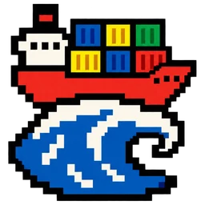
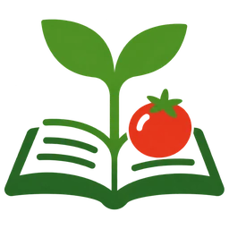
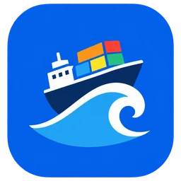
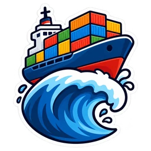
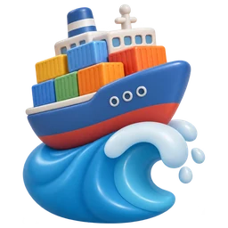
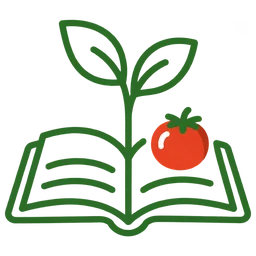
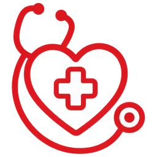

# Style examples

Each section is one template from [`styles.md`](../styles.md), filled with the same
subject for three hypothetical apps. Results vary between runs; these show the general look.

- **Harvest Ledger** (Agriculture: Harvest and produce tracking for small farms). Subject: _a green seedling sprouting from an open ledger book, with a small ripe tomato resting on the pages_
- **PulseCare** (Healthcare: Clinic appointments and patient vitals). Subject: _a rounded red heart with a white medical cross in its center and a stethoscope looped around it_
- **Tidewater Freight** (Logistics: Container shipping and route tracking). Subject: _a small cargo ship carrying a stack of colorful shipping containers, riding a single curling ocean wave_

| Style | Harvest Ledger | PulseCare | Tidewater Freight |
|---|:-:|:-:|:-:|
| [8-bit pixel item](#pixel-8bit) |  |  |  |
| [16-bit pixel item](#pixel-16bit) |  |  |  |
| [HD pixel art](#pixel-hd) |  |  |  |
| [Flat logo mark](#flat-logo) |  |  |  |
| [App tile](#app-tile) |  |  |  |
| [Sticker emblem](#sticker) |  |  |  |
| [Mascot](#mascot) |  |  |  |
| [3D clay / toy](#clay-3d) |  |  |  |
| [Line glyph](#line-glyph) |  |  |  |

<a id="pixel-8bit"></a>

## 8-bit pixel item (`pixel-8bit`)

NES-era sprite: chunky pixels, 3–4 colors, bold black outline

| Harvest Ledger | PulseCare | Tidewater Freight |
|:-:|:-:|:-:|
|  |  |  |

<details><summary>Prompt template</summary>

```text
Retro 8-bit pixel art sprite of {subject}, in the style of an NES-era item pickup. Very coarse grid (about 16x16 sprite scaled up), crisp hard-edged square pixels, no anti-aliasing, a limited palette of 3 to 4 bold colors plus a thick black outline, flat shading. Centered single isolated object, transparent background, no text, no letters.
```

</details>

<a id="pixel-16bit"></a>

## 16-bit pixel item (`pixel-16bit`)

SNES/GBA RPG inventory item: richer palette, highlights, dark outline

| Harvest Ledger | PulseCare | Tidewater Freight |
|:-:|:-:|:-:|
|  |  |  |

<details><summary>Prompt template</summary>

```text
Retro 16-bit pixel art icon of {subject}, like an inventory item in a SNES or Game Boy Advance RPG. Crisp hard-edged pixels on a coarse grid (about 32x32 sprite scaled up), limited vibrant palette with highlight and shadow tones, dark 1-pixel outline. Centered single isolated object, transparent background, no text, no letters.
```

</details>

<a id="pixel-hd"></a>

## HD pixel art (`pixel-hd`)

Modern indie pixel art: finer grid, soft shading, glow accents

| Harvest Ledger | PulseCare | Tidewater Freight |
|:-:|:-:|:-:|
|  |  |  |

<details><summary>Prompt template</summary>

```text
Modern high-detail pixel art icon of {subject}, in the style of a contemporary indie game (fine 64x64 pixel grid). Clean pixel clusters, soft dithered shading, a few glowing accent pixels, subtle rim light, no blur. Centered single isolated object, transparent background, no text, no letters.
```

</details>

<a id="flat-logo"></a>

## Flat logo mark (`flat-logo`)

Simple geometric vector mark, two or three flat colors

| Harvest Ledger | PulseCare | Tidewater Freight |
|:-:|:-:|:-:|
|  |  |  |

<details><summary>Prompt template</summary>

```text
App icon logo mark: {subject}. Flat vector style, simple geometric shapes, two or three flat colors, no gradients, no outline shadow. Iconic and legible at 16px and 256px, centered with even padding, single isolated mark, transparent background, no text, no letters.
```

</details>

<a id="app-tile"></a>

## App tile (`app-tile`)

Bold glyph on a rounded-square colored tile, like a phone app icon

| Harvest Ledger | PulseCare | Tidewater Freight |
|:-:|:-:|:-:|
|  |  |  |

<details><summary>Prompt template</summary>

```text
App icon: a rounded-square tile filled with one bold color, with {subject} as a simple high-contrast glyph in the middle. Flat style, generous padding inside the tile, crisp edges. The tile is centered and everything outside the tile is transparent background. No text, no letters.
```

</details>

<a id="sticker"></a>

## Sticker emblem (`sticker`)

Cartoon sticker with a thick white die-cut border

| Harvest Ledger | PulseCare | Tidewater Freight |
|:-:|:-:|:-:|
|  |  |  |

<details><summary>Prompt template</summary>

```text
Sticker emblem icon: {subject}. Bold cartoon illustration with a thick white die-cut border and a dark outline, vivid colors, simple cel shading. Centered, single isolated subject, legible at small sizes, transparent background, no text, no letters.
```

</details>

<a id="mascot"></a>

## Mascot (`mascot`)

Cute character that personifies the project

| Harvest Ledger | PulseCare | Tidewater Freight |
|:-:|:-:|:-:|
|  |  |  |

<details><summary>Prompt template</summary>

```text
Cute mascot character icon: {subject}. Chibi proportions, big expressive eyes, friendly pose, clean cartoon line art with soft shading, two or three main colors. Head and upper body fill most of the frame, centered, single isolated character, transparent background, no text, no letters.
```

</details>

<a id="clay-3d"></a>

## 3D clay / toy (`clay-3d`)

Soft glossy 3D render, like a vinyl toy or clay model

| Harvest Ledger | PulseCare | Tidewater Freight |
|:-:|:-:|:-:|
|  |  |  |

<details><summary>Prompt template</summary>

```text
3D icon of {subject}, rendered like a glossy vinyl toy or soft clay model. Rounded chunky forms, soft studio lighting, gentle highlights, pastel to medium saturated colors, no harsh shadows on the ground. Centered single isolated object, transparent background, no text, no letters.
```

</details>

<a id="line-glyph"></a>

## Line glyph (`line-glyph`)

Single-weight monoline icon, one or two colors, very minimal

| Harvest Ledger | PulseCare | Tidewater Freight |
|:-:|:-:|:-:|
|  |  |  |

<details><summary>Prompt template</summary>

```text
Minimal line icon of {subject}. Single consistent stroke weight, rounded line caps, one or two colors, no fill or only one small flat fill accent, lots of negative space. Centered with even padding, single isolated glyph, transparent background, no text, no letters.
```

</details>

Regenerate with `scripts/build_examples.py` after changing a template.
